# KinScan

Market intelligence for **Kintara**, a browser MMO with a player-run marketplace where items trade for in-game gold or the game's Solana token, $KINS. KinScan collects the marketplace, on-chain and world data the game exposes, stores it in SQLite, and serves it as a single-page dashboard: price indexes, sales history, a gold price chart, arbitrage between the two currencies, live server and player maps, property ownership, and per-player profiles.

It ran publicly as a hosted site during summer 2026 and runs locally with one command.

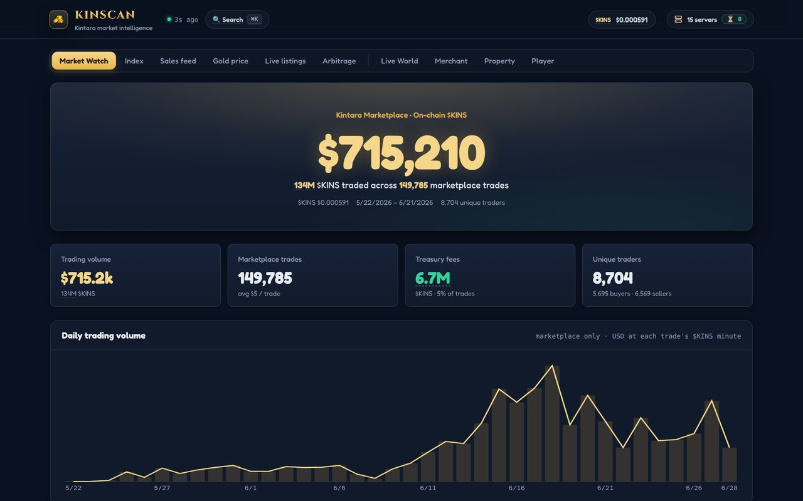

## What's in it

### Market Watch: the economy from the blockchain

Every marketplace trade settles on Solana, and the marketplace takes a 5% fee into a treasury wallet. KinScan reads that wallet's full transaction history, decodes each transaction's balance changes, and keeps only proven marketplace trades. That gives trading volume in USD and $KINS, trade counts, fees, unique buyers and sellers, and a daily volume chart, all from public chain data rather than anything the game reports.

Below the volume chart, a market cap leaderboard ranks every item by supply held across all players times its price, and a separate panel tracks the game's spin wheel, which burns half of every $KINS staked.

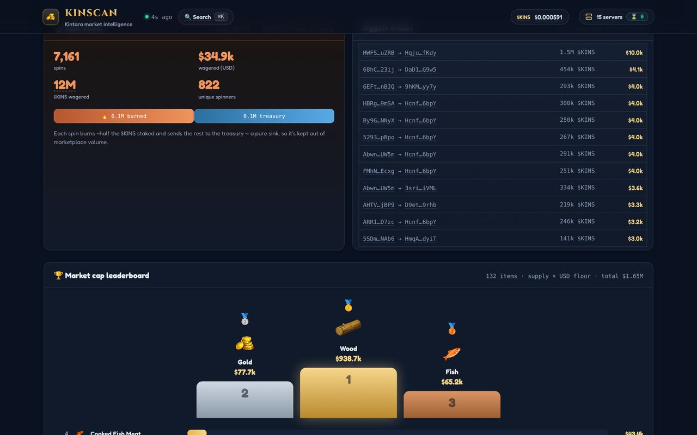

### Index: every item, priced three ways

Every tradable item with its sales, in-world supply, floor price in gold, USD and $KINS, and market cap, filterable by category and time window. Cheap commodities show items-per-gold and price per 1,000 so the numbers stay readable. When live listings aren't available, prices fall back to what items actually sold for, and the table says so.

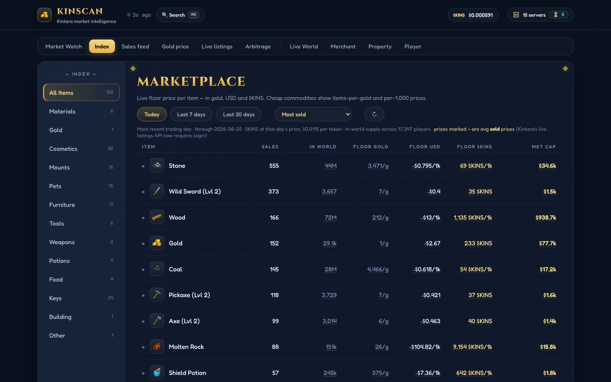

### Sales feed

Completed sales as they happen, with item, quantity, price, seller and how long the listing sat, filterable by currency, category and seller. The strip at the top is KinScan saying how current the data is (more on that below).

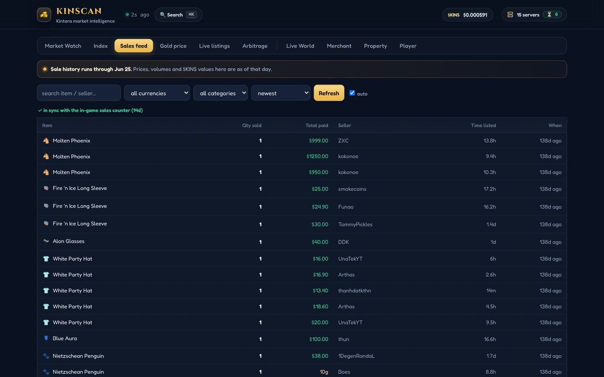

### Gold price

The game has no official gold price, so KinScan measures one: every 3 minutes it averages the three cheapest gold listings priced in $KINS. A second view divides by the token's price to show what gold costs in $KINS, which separates the token's moves from gold's.

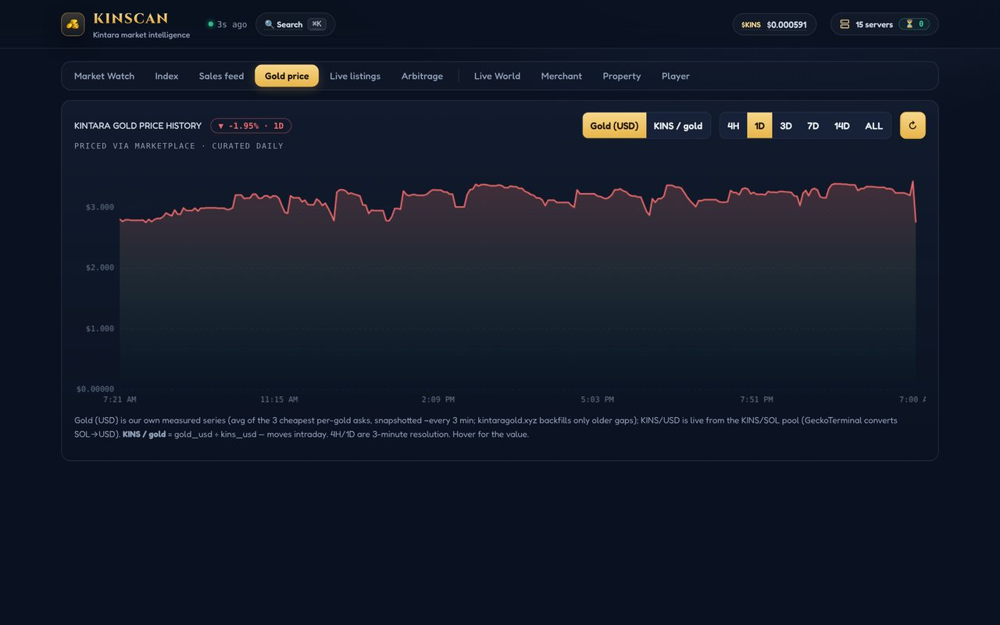

### Merchant

The traveling merchant runs server-wide donation campaigns for five resources. KinScan tracks progress toward each goal, forecasts when the campaign will finish from the donation pace, and prices what it costs to mint gold from raw materials at current market prices.

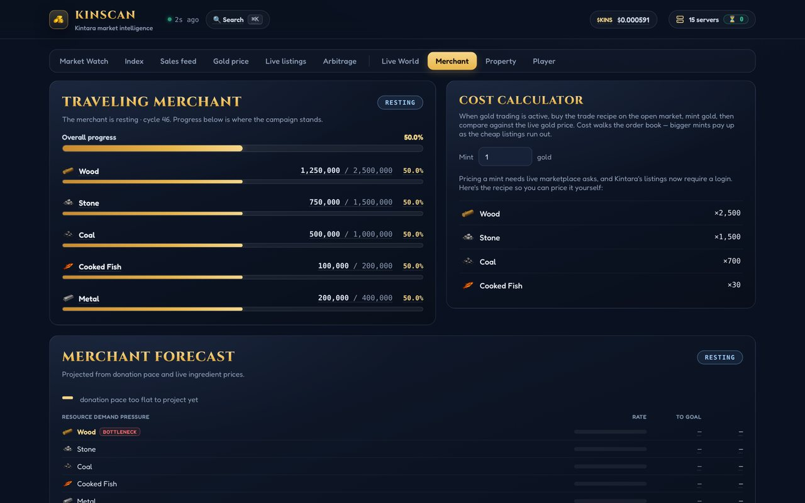

### Property

Ownership of every mansion, house, trailer and flat, drawn on a tilted map of the estate built from the game's own plot coordinates, with owners shown online when they're in the game. Each property has a page with its sale history, valuation and the owner's other holdings.

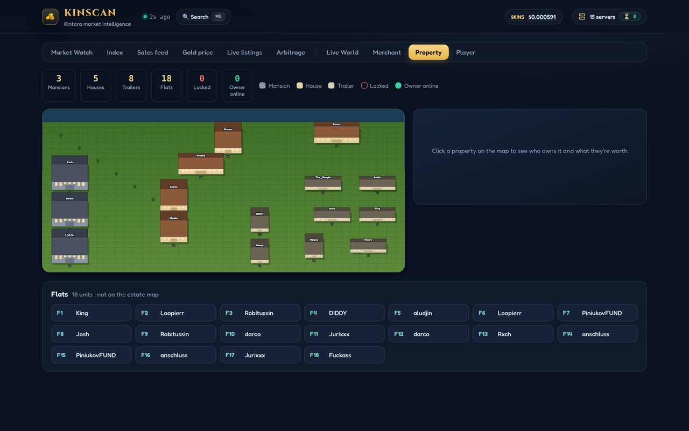

### Player profiles and search

One page per player: marketplace earnings converted to $KINS at each sale day's price, top items, recent sales, property, and on-chain flows for a wallet. Search (⌘K) jumps to any item, seller or tab.

| Player profile | Search |
|---|---|
| 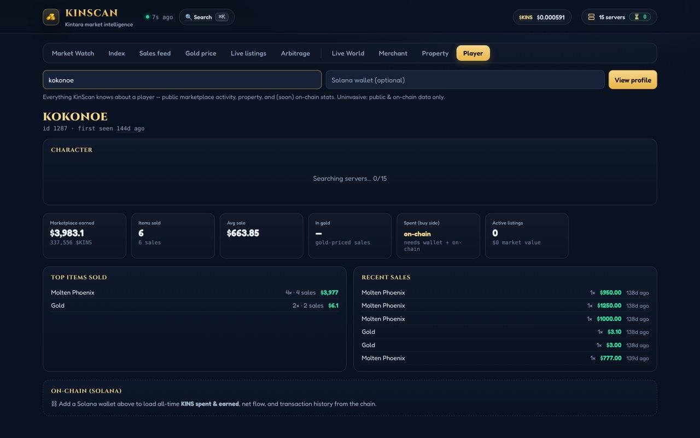 | 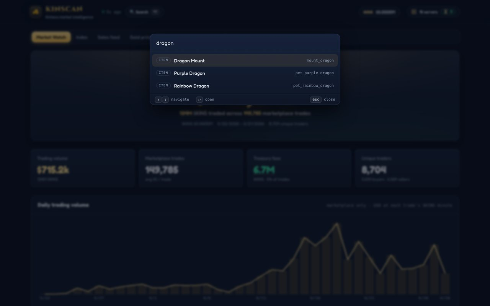 |

### Also

- **Live World:** all 15 game servers grouped by region, with population, queue and boss-cave status. When the game's spectator feed is reachable, it shows who's online on each server and where they are on rendered maps of each zone.
- **Live listings and Arbitrage:** the full order book, plus items that are cheaper in one currency than the other at the current gold rate.
- **Phones:** the whole dashboard works on a phone.

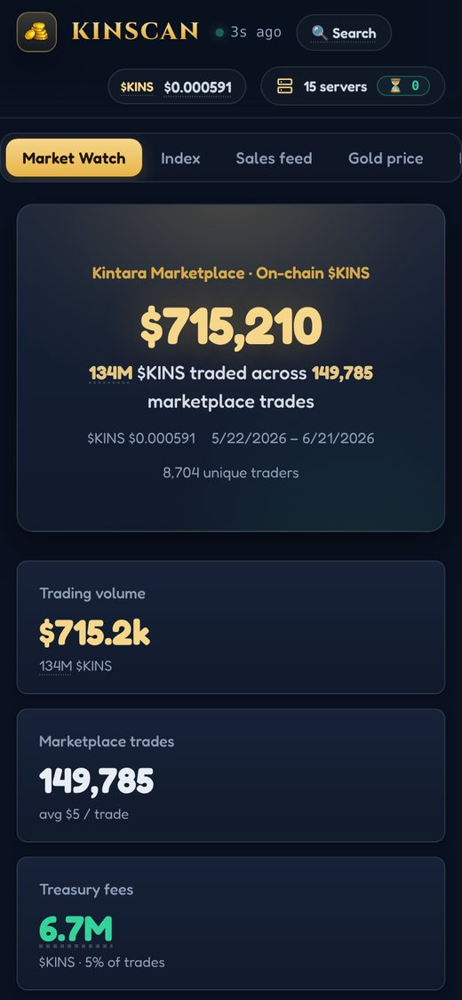

## How it works

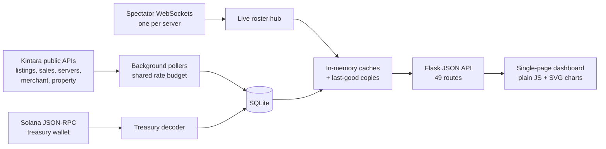

- **One Python process** (Flask served by Waitress) runs the web server and the background threads. Every request to the game goes through one shared pacer, so the collectors can't overload the game's servers or starve each other.
- **Getting the whole order book:** the listings API caps out around 500 results, so KinScan pages it one item at a time, refreshing busy items often and quiet ones rarely, so load scales with trading volume rather than the size of the catalog.
- **Sales history:** the game only publishes daily averages for about 30 days back, so KinScan builds its own permanent archive and watches for new sales to refresh just the items that traded.
- **On-chain decoding:** `build_treasury_index.py` pages the treasury's token account over Solana RPC (with Helius when available), decodes each transaction's balance changes and classifies each flow (marketplace trade, treasury income, payout). The app keeps it in sync incrementally.
- **Live players:** the spectator socket only sends players near one camera in one zone, so each server's connection rotates through every zone to build a full roster of about 80 players.
- **Maps:** `tools/render_maps.py` regenerates top-down images of each zone from the game's world-generation constants and seeded RNG, so player coordinates land on the right tile.
- **Fast first load:** expensive payloads (the whole-ledger Market Watch scan took about 10 seconds) are computed in the background, cached, and saved to disk, so the first visit after a restart is instant.

## Built to keep working when the source changes

Kintara changed underneath KinScan more than once, and each change is handled without breaking the site:

- **Listings went behind a login.** The first 401 trips a circuit breaker: listing requests stop, the site re-checks every 15 minutes, and valuations switch to completed-sale prices. Before this, the collectors retried forever, logging over 93,000 failed requests and starving everything else.
- **The game moved domains** from kintara.gg to kintara.com and changed its server list, property and merchant APIs. Every endpoint now comes from one setting, and the code adapts to the new shapes: 15 servers in three regions, a new property type, new merchant phases.
- **Feeds go down.** Every live feed falls back to its last saved copy, and a strip on each tab says how old the data is instead of showing an error. Rolling 7- and 30-day windows anchor to the last day of data, so the Index stays populated, and old prices are converted to $KINS at that day's token price, not today's.

## Run it

Requires Python 3.10+.

```bash
pip install -r requirements.txt
python3 kintara_tracker.py          # opens http://127.0.0.1:8765
```

On a Mac, double-click `Open KinScan.command` instead. The database starts empty and fills as the collectors run. Useful flags: `--port`, `--no-browser`, `--host 0.0.0.0` when hosting. Set `KINTARA_ORIGIN` to point at a different game host.

## Repository layout

```
kintara_tracker.py        the app: collectors, SQLite layer, JSON API and the embedded dashboard
build_treasury_index.py   Solana treasury decoder, also imported by the app for incremental sync
tools/                    offline helpers: build the compact on-chain dataset, render zone maps
MapImages/, world_map.jpg map art used by Live World and Property
fonts/                    self-hosted Fredoka and Cinzel (SIL Open Font License)
deploy/, Dockerfile       DigitalOcean and Docker deployment scripts
extras/                   a userscript that highlights good deals on the game's own market page
docs/TECHNICAL.md         full engineering notes: every endpoint, table, cache and design decision
docs/DEPLOY.md            hosting guide
```

## Notes

KinScan is an unofficial fan project and isn't affiliated with Kintara. It only reads public data. The screenshots show this copy's saved data, which runs through late June 2026.

## License

Code: MIT, see [LICENSE](LICENSE). Fonts: SIL Open Font License, see `fonts/`.
