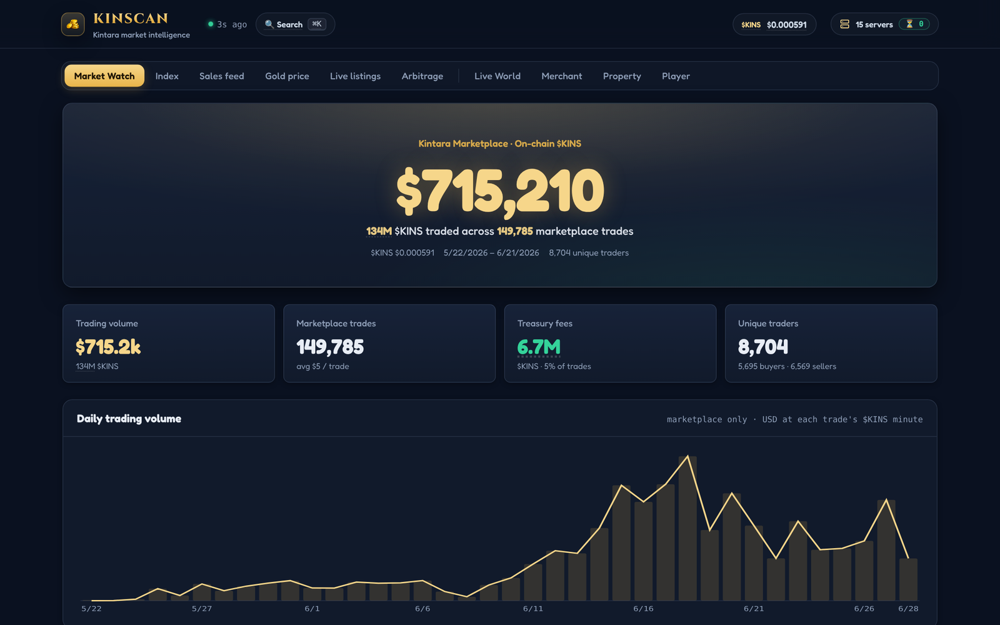
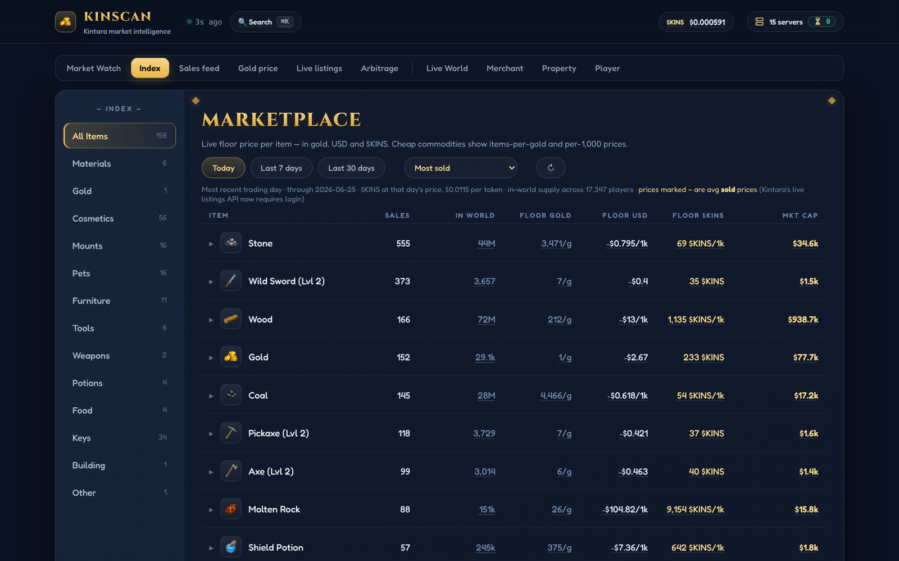

# KinScan

Market intelligence for **Kintara**, a browser MMO with a player-run marketplace where items trade for in-game gold or the game's Solana token, $KINS. KinScan collects the marketplace, on-chain and world data the game exposes, stores it in SQLite, and serves it as a single-page dashboard: price indexes, sales history, a gold price chart, arbitrage between the two currencies, live server and player maps, property ownership, and per-player profiles.

It ran publicly as a hosted site during summer 2026 and runs locally with one command.



## What it does

| Tab | What you get |
|---|---|
| **Market Watch** | Trading volume, trade count, treasury fees and unique traders, rebuilt from every marketplace transaction on the Solana chain. |
| **Index** | Every tradable item ranked by price, 1/7/30-day change, sales velocity, supply held across all players, and market cap. |
| **Sales feed** | Completed sales as they happen, filterable by item, seller and currency. |
| **Gold price** | Intraday price of in-game gold in USD and in $KINS, measured from the cheapest live asks every 3 minutes. |
| **Live listings / Arbitrage** | The full order book, plus items priced cheaper in one currency than the other at the current gold rate. |
| **Live World** | All 15 game servers by region, with who's online and where they are on rendered maps of each zone. |
| **Merchant** | Progress of the server-wide donation campaign, a completion forecast, and the cost of minting gold from raw materials. |
| **Property** | Ownership of every mansion, house, trailer and flat on an isometric estate map, with sale history and valuations. |
| **Player** | One page per player: sales, earnings, top items, property, and on-chain $KINS flows for a wallet. |

| Index | Property |
|---|---|
|  |  |

## How it works

- **One Python process** (Flask served by Waitress) runs the web server and a set of background threads that poll the game's public APIs on a shared rate budget.
- **SQLite** holds listings, completed sales, daily price series, gold price snapshots, merchant history and analytics. Hot API responses are cached in memory and persisted, so the first page load after a restart is instant.
- **On-chain data:** `build_treasury_index.py` reads the marketplace treasury's token account over Solana JSON-RPC, decodes each transaction's balance changes, and classifies marketplace trades by their 5% fee. The app keeps that ledger in sync on its own.
- **Live player positions** come from the game's public spectator WebSocket. One socket per server rotates through every zone to build a full roster.
- **Maps:** `tools/render_maps.py` regenerates top-down images of each zone from the game's world-generation constants and seeded RNG, so player coordinates land on the right tile.
- **Resilient by design:** every external feed falls back to its last saved copy, and the UI says how old the data is. When Kintara put its order book behind a login, valuations switched to completed-sale prices automatically.
- **Frontend:** a single embedded page of plain HTML, CSS and JavaScript with hand-rolled SVG charts. No build step.

## Run it

Requires Python 3.10+.

```bash
pip install -r requirements.txt
python3 kintara_tracker.py          # opens http://127.0.0.1:8765
```

On a Mac, double-click `Open KinScan.command` instead.

The database starts empty and fills as the pollers run. Useful flags: `--port`, `--no-browser`, `--host 0.0.0.0` when hosting. Set `KINTARA_ORIGIN` to point at a different game host.

## Repository layout

```
kintara_tracker.py        the app: pollers, SQLite layer, JSON API (49 routes) and the embedded dashboard
build_treasury_index.py   Solana treasury decoder, also imported by the app for incremental sync
tools/                    offline helpers: build the compact on-chain dataset, render zone maps
MapImages/, world_map.jpg map art used by Live World and Property
fonts/                    self-hosted Fredoka and Cinzel (SIL Open Font License)
deploy/, Dockerfile       DigitalOcean and Docker deployment scripts
extras/                   a userscript that highlights good deals on the game's own market page
docs/TECHNICAL.md         full engineering notes: every endpoint, table, cache and design decision
docs/DEPLOY.md            hosting guide
```

## Notes

- KinScan is an unofficial fan project and isn't affiliated with Kintara. It only reads public data.
- Kintara moved domains and changed parts of its API in late 2026. The app was updated for the new hosts and shows saved data, labeled with its date, wherever a feed is no longer public.

## License

Code: MIT, see [LICENSE](LICENSE). Fonts: SIL Open Font License, see `fonts/`.
